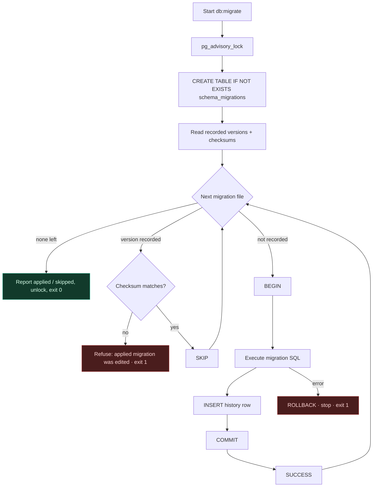
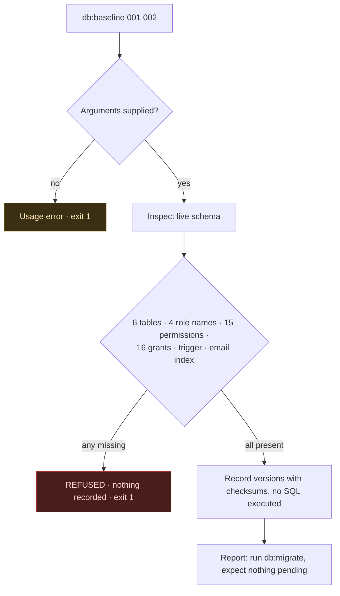
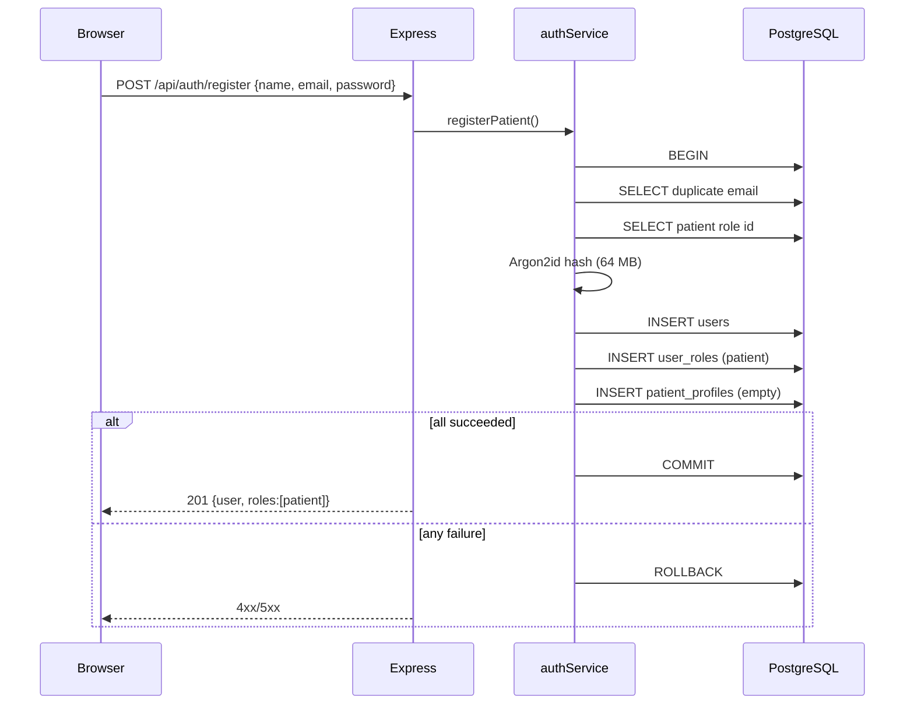

# Medora — Changes & Next Steps

**Period covered:** 26 October 2026
**Repository:** `med` (Medora Healthcare) · base commit `2de2bfb`

**Scope:** Every change made in this working session — audit, environment, migration infrastructure, Phase 2 schema, application code, and documentation — plus the sequenced work that remains.

---

## 1. At a glance

Six tracked files were modified and eight files/directories were added. No frontend file was touched.

| Area | Change | Files |
|---|---|---|
| Audit | Read-only security and back-end review; 31 findings | `audit/` (3 files, 1,131 lines) |
| Analysis | `DB.md` roadmap analysis; Phase 2 decision analysis | `DB_NEXT_STEP.md`, `PHASE2_003_DECISIONS.md` |
| Environment | `.env` created, database connected, `001`/`002` applied | `Backend/.env` (untracked), `Backend/.env.example` |
| Migration infra | History table, checksums, advisory lock, baselining | `migrate.js` (rewritten), `baseline.js` (new), `lib/migrations.js` (new), `package.json` |
| Schema | Phase 2 profile tables | `003_patient_doctor_profiles.sql` (new), `medora.dbml` |
| Application | Registration creates the profile transactionally | `authService.js` |
| Docs & config | Onboarding README, ignore rules | `README.md`, `.gitignore` |

```diff
 6 files changed, 398 insertions(+), 37 deletions(-)
```

---

## 2. Work timeline

| Phase | Work | Outcome |
|---|---|---|
| 1 | Full repository audit against the Back-End Audit brief | 31 findings; verdict **not ready** for patient data |
| 2 | `DB.md` analysis to determine the objective and next step | Next step identified as §8 step 3 (migration tracking) |
| 3 | Database connection | `.env` created; `medora_db` found **empty**; `001`+`002` applied and verified |
| 4 | Migration tracking (§8 step 3) | `schema_migrations`, checksums, advisory lock, `db:baseline`, onboarding docs |
| 5 | Phase 2 schema (§8 step 4) | Four decisions resolved; `003` written, tested, applied |
| 6 | Application wiring | Registration now creates the profile in the same transaction |

---

## 3. Phase 1 — Audit (read-only)

No repository file was modified. Three deliverables were created in `audit/`:

| File | Contents |
|---|---|
| `audit/BACKEND_AUDIT_REPORT.md` (860 lines) | Executive summary, architecture with trust boundaries, 31 findings, endpoint matrix, schema drift, traceability, dependency inventory, roadmap |
| `audit/COVERAGE_LEDGER.md` (271 lines) | All 217 tracked files with review status |
| `audit/findings.json` | 31 structured findings for issue-tracker import |

**Findings:** 1 Critical · 6 High · 15 Medium · 9 Low. Verdict: **not ready** to hold real patient data.

The most consequential finding for the work that followed was **DB-001** — the migration runner had no history table — because `DB.md` §6 independently identified the same problem as a precondition for Phase 2. Two audit findings were subsequently resolved by work in this session; the rest remain open and are listed in §9.

---

## 4. Phase 2 — Environment and database connection

### 4.1 What was found

| Check | Result |
|---|---|
| PostgreSQL | 18.6 installed at `C:\Program Files\PostgreSQL\18`, service `postgresql-x64-18` running |
| Authentication | `pg_hba.conf` requires `scram-sha-256` for `local`, `127.0.0.1/32` and `::1/128` — no trust path |
| Existing credentials | None: no `.env`, no `pgpass.conf`, no `PG*` variables, no `psql` on `PATH` |
| `medora_db` | **Existed but completely empty** — zero tables |

The empty database was the significant discovery: `DB.md`'s Gate 1 verification described the *original developer's* database, not this machine. Nothing had ever been migrated here.

### 4.2 What was created

`Backend/.env` (git-ignored, not committed):

```dotenv
DB_HOST=127.0.0.1      # not "localhost": avoids ::1 resolution on Windows
DB_PORT=5432
DB_NAME=medora_db
DB_USER=postgres
DB_PASSWORD=…          # supplied by the owner, never written to any tracked file
PORT=5000
NODE_ENV=development
FRONTEND_ORIGIN=http://localhost:3000
```

`127.0.0.1` was chosen deliberately: Node may resolve `localhost` to `::1` while the server listens on IPv4, producing a confusing `ECONNREFUSED`.

### 4.3 Verification

```
$ npm run db:test
PostgreSQL connection successful. Database: medora_db
```

Migrations `001` and `002` were then applied **once**, which is safe only because the database was empty. Result matched `DB.md`'s Gate 1 expectations exactly:

| Check | Expected | Actual |
|---|---|---|
| roles | 4 | 4 (`admin, doctor, patient, receptionist`) |
| permissions | 15 | 15 |
| role_permissions | 16 | 16 |
| users / user_roles / sessions | 0 | 0 / 0 / 0 |
| trigger | `trg_enforce_single_admin` enabled | enabled |
| index | `uq_users_email_lower` | present |

### 4.4 Admin account

An Admin already existed — `alaaeldeen@medora.local`, created at 09:15Z by the owner — and `bootstrap:admin` correctly refused to create a second one (`[Policy Violation] An Admin account already exists`).

The existing account was verified **without touching its password**: `status=active`, `email_verified_at` set, Argon2id hash, role `admin`, and `GET /api/admin/check` returning `200 Admin authorization verified`. A temporary session row was minted for the test and deleted afterwards.

---

## 5. Phase 3 — Migration infrastructure

This was `DB.md` §8 step 3, and the precondition for any future schema change. It replaced a runner that re-executed a hard-coded list of files on every invocation.

### 5.1 Before and after

| Concern | Before | After |
|---|---|---|
| Discovery | Hard-coded array of two filenames | Directory scan of `database/migrations/*.sql`, sorted |
| History | None | `schema_migrations (version, name, checksum, applied_at)` |
| Re-run behaviour | Re-executes everything, fails on `CREATE TABLE` | Skips recorded versions |
| Drift detection | None | SHA-256 checksum per file; refuses to continue on mismatch |
| Atomicity | Per-file transaction, but no history row | Migration **and** its history row commit together |
| Concurrency | Unprotected | `pg_advisory_lock` for the whole run |
| Failure handling | Rollback, exit 1 | Rollback, stop at the failing file, exit 1 |
| Existing databases | No path | `db:baseline -- 001 002` verifies then records without executing |

Checksums are computed with `\r\n` normalised to `\n`, so a Windows and a Linux checkout of the same file produce the same hash and do not raise a false drift warning.

### 5.2 Migration runner flow



### 5.3 Baseline flow



Versions must be named explicitly — there is deliberately no "record everything" mode, so a future `003` can never be marked applied by accident.

### 5.4 Files

| File | Lines | Role |
|---|---:|---|
| `Backend/scripts/lib/migrations.js` | 106 | Discovery, checksums, history DDL, lock key. No side effects on import |
| `Backend/scripts/migrate.js` | 144 | Apply pending migrations (was 76 lines) |
| `Backend/scripts/baseline.js` | 203 | Record an existing schema after verification |
| `Backend/package.json` | +1 | `db:baseline` script |

### 5.5 Verification

| Test | Result |
|---|---|
| Fresh database, first run | Applied `001`, `002`; recorded 2 |
| Second run | Skipped 2, applied 0, exit 0 |
| Tampered checksum | `Checksum mismatch for 001_identity_access.sql`, exit 1 |
| Baseline on empty database | `[REFUSED] … Missing tables`, nothing recorded, exit 1 |
| Baseline with no arguments | Usage error, exit 1 |
| Two concurrent runners | Run 1 applied 2, run 2 skipped 2, no errors |

---

## 6. Phase 4 — Schema migration `003`

### 6.1 The four decisions and how they were resolved

`DB.md` §8 left these to the team; they are documented with full trade-offs in `PHASE2_003_DECISIONS.md`.

| # | Decision | Resolution | Rationale |
|---|---|---|---|
| 1 | Are DOB / phone / gender required? | **Nullable in the database; completeness enforced by the API** via `profile_completed_at` | `DB.md` §7 forbids collecting them at sign-up, so no value can exist when the row is created. `NOT NULL` would force a form before a profile can exist |
| 2 | Auto-create or lazy profile? | **Auto-create in the registration transaction, plus idempotent backfill** | `GET /api/patients/me` always returns one stable shape; no "profile does not exist yet" case for the client |
| 3 | `specialty` free text or normalised? | **Normalised `specialties` table**, seeded with 12 values | The frontend already carried two conflicting lists (12 in `departments.ts`, 6 in `doctors.ts`); free text would let the database diverge the same way |
| 4 | Who may edit `license_number`? | **Admin-only; doctor read-only.** `NOT NULL` + unique | `Admin.md` §6.3 requires credential verification; a self-editable licence makes "verified" meaningless |

One naming decision inside #3: the table is `specialties`, not `departments`, because `DB.md` is the schema authority and a label mapping in the UI is cheaper than renaming a populated column later.

### 6.2 Objects created

| Object | Type | Key constraints |
|---|---|---|
| `patient_profiles` | table | PK `user_id` → `users` **CASCADE**; `gender` CHECK (4 values); `date_of_birth` CHECK `> 1900-01-01`; `profile_completed_at` |
| `specialties` | table | `UNIQUE(name)`, `UNIQUE(slug)`, `is_active`; 12 seeded rows |
| `doctor_profiles` | table | PK `user_id` → `users` **CASCADE**; `specialty_id` NOT NULL → `specialties` **RESTRICT**; `license_number` NOT NULL + unique; `license_verified_at`, `license_verified_by` → `users` **SET NULL** |
| `set_updated_at()` | function | `BEFORE UPDATE` trigger function |
| `trg_patient_profiles_updated_at` | trigger | Maintains `updated_at` |
| `trg_doctor_profiles_updated_at` | trigger | Maintains `updated_at` |
| `uq_doctor_profiles_license` | unique index | One doctor per licence |
| `idx_doctor_profiles_specialty` | index | Directory filtering |

### 6.3 Deliberate omissions

- **No role enforcement at the database level.** The primary key guarantees one profile per user, not that the user holds the matching role. `DB.md` §7 places that in the service layer, where the authorisation decision already lives.
- **`users.updated_at` is still unmaintained.** Fixing it would modify an applied table and belongs in its own migration.
- **No clinical columns** — diagnosis, allergies, medications, transcripts and reports are forbidden in a profile table by `DB.md` §9.
- **`CURRENT_DATE` is not used in any CHECK.** It is not immutable, so "date of birth not in the future" is validated in the API instead; the constraint only carries the literal floor.

### 6.4 Verification

Run first on a disposable database, then on `medora_db`.

| Test | Expected | Result |
|---|---|---|
| Specialties seeded | 12 | 12 |
| Gender outside allowed list | `23514` | `23514` |
| DOB before 1900 | `23514` | `23514` |
| Duplicate profile for same user | `23505` | `23505` |
| Duplicate licence number | `23505` | `23505` |
| Whitespace-only licence | `23514` | `23514` |
| `specialty_id` NULL | `23502` | `23502` |
| Delete specialty in use | `23001` | `23001` |
| Delete user → profile removed | cascade | cascade |
| Backfill creates missing profile | 1 row | 1 row |
| Backfill run twice | still 1 row | still 1 row |
| `updated_at` on UPDATE | advances | advances |

> **Note on `23001`:** `ON DELETE RESTRICT` raises `restrict_violation` (`23001`), not `foreign_key_violation` (`23503`). The first test run asserted the wrong code and reported a false failure; the constraint was correct throughout.

---

## 7. Phase 5 — Application code

### 7.1 `Backend/services/authService.js` (+20 lines)

Two changes inside `registerPatient`, both inside the existing transaction.

**1. Create the profile atomically:**

```js
await client.query(
  `INSERT INTO patient_profiles (user_id)
   VALUES ($1)`,
  [newUser.id]
);
```

Public sign-up still accepts exactly three fields. The row is created empty; the patient completes it later via My Profile.

**2. Turn a missing table into an actionable error:**

```js
if (err.code === "42P01") {
  const schemaError = new Error(
    "Database schema is out of date: patient_profiles is missing. " +
    "Run `npm run db:migrate` in Backend/."
  );
  schemaError.statusCode = 500;
  throw schemaError;
}
```

Without this, a database behind the code produces an opaque `500`. With it, the operator is told exactly what to run.

### 7.2 Registration flow after the change



### 7.3 Verification

| Test | Result |
|---|---|
| Registration creates a profile row | `201`, 1 row |
| New profile is empty by default | `dob`, `gender`, `completed_at` all NULL |
| Forced profile-insert failure | registration fails, **0 orphan users, 0 orphan roles** |
| Registration after fault removed | `201` |
| New patient can sign in | `200` |
| Delete user → profile cascades | profile count returns to 0 |

---

## 8. Phase 6 — ERD and documentation

### 8.1 `database/medora.dbml` (+46 lines)

Three tables and four references appended to the single comprehensive ERD:

```
Ref: users.id - patient_profiles.user_id        [delete: cascade]   // 1:0..1
Ref: users.id - doctor_profiles.user_id         [delete: cascade]   // 1:0..1
Ref: specialties.id < doctor_profiles.specialty_id [delete: restrict]
Ref: users.id < doctor_profiles.license_verified_by [delete: set null]
```

Each table carries notes for the constraints DBML cannot express — the CHECK lists, the unique licence index, the trigger, and the rule that `license_number` is not self-editable.

### 8.2 `README.md` (1 line → 224 lines)

Now covers: prerequisites, two-package-tree install, `.env` creation, database creation, connection test, **both** migration paths (fresh vs existing), admin bootstrap, running both servers, a command reference, migration rules, role policy, project structure, troubleshooting, and a document index.

### 8.3 `Backend/.env.example` (new, 31 lines)

Variable names with `CHANGE_ME` placeholders — no values. Documents why `127.0.0.1` is preferred and why `NODE_ENV` must stay `development` locally.

### 8.4 `.gitignore`

```diff
- .env*.local
+ .env
+ .env.*
+ !.env.example
```

The previous pattern did not match a bare `.env`, so a root-level secrets file could have been committed. `.env.example` remains trackable.

### 8.5 Analysis documents

| File | Purpose |
|---|---|
| `DB_NEXT_STEP.md` (327 lines) | `DB.md` objective and next-step analysis, with claim-by-claim repository verification and two status updates |
| `PHASE2_003_DECISIONS.md` (368 lines) | The four decisions with options, trade-offs, recommendations and the resulting DDL |

---

## 9. Current state

### 9.1 Database

```
Database:  medora_db
Migrations: 001, 002, 003
Tables (10): doctor_profiles, patient_profiles, permissions, role_permissions,
             roles, schema_migrations, sessions, specialties, user_roles, users
Rows: users=1 (admin) · patient_profiles=0 · doctor_profiles=0 · specialties=12
```

### 9.2 Repository

```
Modified:  .gitignore · Backend/package.json · Backend/scripts/migrate.js
           Backend/services/authService.js · README.md · database/medora.dbml
Added:     Backend/.env.example · Backend/scripts/baseline.js · Backend/scripts/lib/
           database/migrations/003_patient_doctor_profiles.sql
           DB_NEXT_STEP.md · PHASE2_003_DECISIONS.md · audit/
Untracked, not project code: .workbuddy-ai/ (agent working memory)
```

`database/medora.dbdiagram` appears as modified but `git diff` is empty — a CRLF artefact, not a content change.

### 9.3 Test suite

```
$ npm test
# tests 8 · pass 8 · fail 0 · skipped 0
```

Before this work the database block skipped itself, so the suite reported 7 pass / 1 skipped and had never exercised a real database.

---

## 10. What was deliberately not changed

| Area | Reason |
|---|---|
| **All frontend files** | Explicitly out of scope for this request |
| `001` / `002` migrations | `DB.md` §9 forbids editing applied migrations; the runner now enforces this with checksums |
| `users.updated_at` | Would modify an applied table; belongs in its own migration |
| Profile API endpoints | `DB.md` §8 step 5, not step 4 |
| Admin Doctors & Staff module | `DB.md` §8 step 6 — a separate module |
| Role enforcement in SQL | `DB.md` §7 places it in the service layer |
| The three signup fields still discarded by the UI | Frontend change; flagged, not made |

---

## 11. Next steps

### 11.1 Immediate — the next `DB.md` milestone (§8 step 5)

Build the profile APIs, in this order:

| # | Work | Notes |
|---|---|---|
| 1 | `GET /api/patients/me` | `requireAuth` + `requireRole("patient")`; `user_id` from the session, never from the request |
| 2 | `PATCH /api/patients/me` | Allowlist: `date_of_birth`, `phone`, `gender`. Validate DOB not in the future, phone normalised to E.164, gender in the four permitted values. Set `profile_completed_at` when the required set is present |
| 3 | `GET /api/doctors/me` | `requireAuth` + `requireRole("doctor")`; joins `specialties` |
| 4 | `PATCH /api/doctors/me` | Allowlist **excludes** `license_number` and `license_verified_*` |
| 5 | Cross-user access test | Patient A must receive `403`/`404` for patient B's profile |
| 6 | Doctor fixture test | Provisioned by script, never by public sign-up |

Module layout mirrors the existing pattern: `routes/patientRoutes.js`, `routes/doctorRoutes.js`, `controllers/`, `services/`, reusing `requireAuth`, `requireRole`, `db.js` and the error handler.

### 11.2 Short term — frontend alignment

| # | Work | Why |
|---|---|---|
| 7 | Remove `phone`, `dob`, `gender` from the signup form, or wire them to the profile API | The form collects and silently discards them today; `DB.md` §7 requires a three-field signup |
| 8 | Build My Profile against the new endpoints | The destination those fields were always meant for |
| 9 | Remove the 1,500 ms `setTimeout` before the post-signup redirect | Violates `AGENTS.md` §5 |

### 11.3 Short term — audit remediation still open

These come from `audit/BACKEND_AUDIT_REPORT.md` and are independent of Phase 2.

| # | Item | Finding |
|---|---|---|
| 10 | Upgrade Next.js 14.2.15 (4 critical advisories incl. unauthenticated RCE) | DEP-001 |
| 11 | Logout fails when the CSRF cookie is absent; session survives | AUTH-001 |
| 12 | Login rate limit is one global bucket behind the Next.js proxy | SEC-001 |
| 13 | No rate limit on registration (64 MB per attempt) | SEC-002 |
| 14 | `pool.on('error')` and query/connection timeouts | REL-001, REL-002 |
| 15 | Audit trail for authentication events | DATA-001 |

### 11.4 Medium term

| # | Work |
|---|---|
| 16 | Admin Doctors & Staff Management: `POST /api/admin/doctors` with transactional provisioning (user + role + profile), then invitations |
| 17 | Invitation/token flow so an admin never knows a doctor's password |
| 18 | `users.updated_at` trigger in its own migration |
| 19 | Session retention job; `user_roles(role_id)` index |

---

## 12. Carried-forward decisions and caveats

| Item | Status |
|---|---|
| `gender` vs `sex_at_birth` | Assumed `gender` (patient-facing). If clinical use appears, this becomes a column change |
| Phone format | E.164 assumed; not yet enforced anywhere |
| Minimum patient age | None assumed — Pediatrics is in scope |
| Licence uniqueness scope | Global assumed; may need per-board scoping |
| Specialty naming | `specialties` in the database; the UI may still say "department" |
| `specialties` seed | Provisional — the authoritative list belongs to the Admin Departments module |
| Migration rollback | No down-migrations exist. Reversal is manual and documented per change |

---

## 13. Reproduction

### Fresh clone to working system

```powershell
npm install
npm --prefix Backend install
Copy-Item Backend\.env.example Backend\.env     # then set DB_USER / DB_PASSWORD
# create the database
npm --prefix Backend run db:test
npm --prefix Backend run db:migrate
npm --prefix Backend run bootstrap:admin
npm run dev
```

### Applying this session's schema to another existing database

```powershell
npm --prefix Backend run db:baseline -- 001 002   # only if the schema predates tracking
npm --prefix Backend run db:migrate               # applies 003, records it
```

### Reversing `003`

Only safe while the tables are empty. In dependency order:

```sql
DROP TRIGGER IF EXISTS trg_doctor_profiles_updated_at ON doctor_profiles;
DROP TRIGGER IF EXISTS trg_patient_profiles_updated_at ON patient_profiles;
DROP TABLE IF EXISTS doctor_profiles;
DROP TABLE IF EXISTS patient_profiles;
DROP TABLE IF EXISTS specialties;
DROP FUNCTION IF EXISTS set_updated_at();
DELETE FROM schema_migrations WHERE version = '003';
```

Also revert the `INSERT INTO patient_profiles` block and the `42P01` branch in `authService.js`, or registration will fail against the rolled-back schema.

---

## 14. Document index

| File | Contents |
|---|---|
| `CHANGES_AND_NEXT_STEPS.md` | This document |
| `audit/BACKEND_AUDIT_REPORT.md` | Full security and back-end audit |
| `audit/COVERAGE_LEDGER.md` | Per-file review status (217 files) |
| `audit/findings.json` | 31 findings as structured data |
| `DB_NEXT_STEP.md` | `DB.md` objective and next-step analysis |
| `PHASE2_003_DECISIONS.md` | The four Phase 2 decisions with trade-offs |
| `README.md` | Setup and onboarding |
| `AGENTS.md` | Repository conventions |
